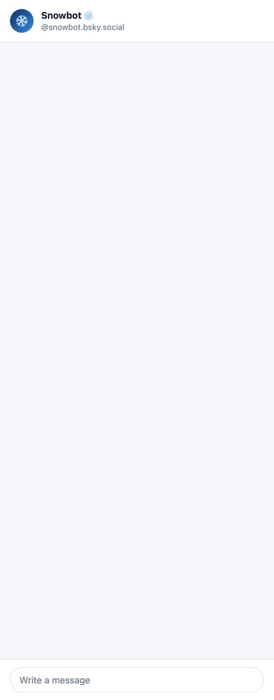

# Snowbot ❄️

An experimental Bluesky bot that answers "how's the snow?" for 110 ski resorts across the US, Canada, Europe, Japan, and New Zealand. Send it a DM with a resort name, or browse resorts by region from a numbered menu. It runs on a Raspberry Pi, so replies can take a little while.

**Try it:** [@snowbot.bsky.social](https://bsky.app/profile/snowbot.bsky.social)

<p align="center">
  
</p>

<sub>The demo is generated by `scripts/make_dm_demo.py` from the bot's own menu code. The report uses real Open-Meteo data for Breckenridge from November 12, 2026, early in the season, so it shows no snow yet.</sub>

---

## Using Snowbot

### In a DM (private)

| Send | You get |
|---|---|
| `Vail`, `Park City`, "snow at Alta?" | That resort's snow report and 7-day forecast |
| `menu` | The main menu: snow reports, learn about snow, photos, playlists, help |
| `Colorado`, `Japan`, `US Midwest` | A numbered list of resorts in that state, country, or region |
| a number | Picks from the list you were just shown |
| `back` | Goes up one level (report → resort list → regions → main menu) |
| `map Vail`, `Vail trail map` | A link to the resort's own trail map. Plain `map` means the resort you just asked about. |
| `set home Breckenridge` | Saves a home resort (shown in `settings`) |
| `set region Colorado` | Saves a home area (state, country, or region). "Snow reports" then opens it. |
| `clear home`, `clear region`, `reset` | Clears those settings |
| `settings` | Shows what's saved |
| `learn`, `music`, `photos` | Snow science links, mountain playlists, a snow photo |
| `help` | All of the above |

### In public

Post `@snowbot.bsky.social Mammoth` and the bot replies to your post with the report. If a mention doesn't name a resort it recognizes, the bot stays quiet rather than replying to chatter.

### What's public and what's private

| Trigger | Where the reply goes |
|---|---|
| Anything sent by DM | Back to you by DM |
| A public mention that names a resort | A public reply in your thread |
| `photos` (by DM) | A **public post** on the bot's feed that tags you, because Bluesky DMs can't carry images. The bot DMs you the link. |

Each user gets their own photo order: you'll see every photo once before any repeats.

---

## Where the data comes from

| Source | What it provides | Coverage |
|---|---|---|
| [Open-Meteo](https://open-meteo.com/) | Current temperature, wind, skies, and visibility; snowfall over the past 24, 48, and 72 hours; modeled snow depth; 7-day forecast | Every resort |
| [USDA NRCS SNOTEL](https://www.nrcs.usda.gov/wps/portal/wcc/home/) (via the AWDB REST API) | Measured snow depth and snow water equivalent from the nearest automated snow station | Western US resorts with a station nearby |

Resort lists mark the data quality for each resort:

- `❄` a SNOTEL station on or very near the mountain
- `≈` a station nearby
- `○` model data only (Open-Meteo)

The resort table (names, aliases, coordinates, elevation, nearest SNOTEL station) is hand-curated in `snowbot/snow/resolver.py`. A name not in the table falls back to geocoding through OpenStreetMap Nominatim, so the bot can still answer for a smaller hill. Reports are cached for 30 minutes.

> The code also includes an optional [SnoCountry](https://www.snocountry.com/) client for resort-reported conditions (lifts open, base depth). It isn't enabled in the running bot.

---

## How it works

```
 Alert channels                  Snowbot (bot.py)                    Notify channels
 ──────────────                  ────────────────                    ───────────────
 DM poller       ──┐                                            ┌──▶ Bluesky DM
 (chat.bsky)       │   AlertRequest   ┌──────────────────┐      │    (replies to DMs)
                   ├────────────────▶ │ commands, menus, │ ─────┤
 Firehose        ──┤                  │ sessions, prefs  │      │
 (@mentions)       │                  └────────┬─────────┘      └──▶ Bluesky post
                   │                           │                     (mention replies,
 File inbox      ──┘                           ▼                      photos, broadcasts)
 (YAML drops)                  SnowService ──▶ SnowFormatter
                               resolver → Open-Meteo + SNOTEL → ≤300-char posts
                                         ▲
                                   SQLite (data/snowbot.db)
                         requests · responses · snow cache · user prefs
                         DM sessions · seen DM ids · photo history
```

- **Alert channels** turn incoming activity into `AlertRequest`s:
  - The **DM poller** polls Bluesky chat. It polls faster for a couple of minutes after a message arrives.
  - The **firehose** listener watches the public network for posts that mention the bot.
  - The **file inbox** picks up YAML files dropped into `inbox/`. It's used for scripted broadcasts.
- **The bot** (`bot.py`) decides what each request is: a settings command, a menu step, a numbered pick from the last list, or a resort name. DM menu state is kept per user in `dm_sessions` (30-minute timeout), so `1` means "the first resort" right after a resort list and "snow reports" from the main menu.
- **SnowService** resolves the name to a resort, fetches Open-Meteo and SNOTEL data (cached), and builds a `SnowReport`. **SnowFormatter** renders it as posts of 300 characters or fewer. DMs join those posts into messages of up to 1,000 characters.
- **Notify channels** send the result back by DM or as a public post. Replies end with the response time, for example "Responded in 23.6s on a pi."

---

## Running your own

Requires Python 3.9+ and a Bluesky account for the bot with an [app password](https://bsky.app/settings/app-passwords). The app password needs DM access.

```bash
git clone https://github.com/jimmoffitt/bluesky-snowbot.git
cd bluesky-snowbot
python3 -m venv .venv && source .venv/bin/activate
pip install -r requirements.txt

cp .local.env.example .local.env   # then set BSKY_HANDLE and BSKY_APP_PASSWORD
python main.py
```

Useful settings in `.local.env`:

| Key | Default | Purpose |
|---|---|---|
| `BSKY_HANDLE`, `BSKY_APP_PASSWORD` | required | The bot's account |
| `DB_PATH` | `data/snowbot.db` | SQLite database |
| `PHOTOS_PATH` | `snowbot/data/photos` | Photo files. They aren't in git; captions are in `snowbot/data/photos.csv`. |
| `SERVER_TYPE` | `laptop` | Shown in the response-time footer |
| `SNOW_CACHE_TTL_MINUTES` | `30` | How long a report is reused |
| `DM_POLL_INTERVAL_SEC` | `5` | DM polling interval when idle |
| `LOG_LEVEL` | `INFO` | |

For anyone to be able to DM the bot, its account must accept DMs from everyone. `scripts/setup_profile.py --apply` sets that, along with the bio and a pinned getting-started post.

### Running on a Raspberry Pi

`snowbot.service` is a systemd unit that runs `main.py` from the project's virtualenv and restarts it on failure. Edit `User=` and the paths in it to match your Pi, then:

```bash
sudo cp snowbot.service /etc/systemd/system/
sudo systemctl enable --now snowbot
journalctl -u snowbot -f
```

### Tests

```bash
pytest
```

The tests don't touch the network. `tests/test_bot_dm_flow.py` drives the real request handler through whole DM conversations using fake notify channels.

---

## Project layout

```
main.py                     entry point (logging + build_bot().start())
bot.py                      orchestrator: routing, commands, menus, sessions
snowbot/
  channels/alert/           dm_poller.py, firehose.py, file_watcher.py
  channels/notify/          bluesky_dm.py, bluesky_post.py
  snow/                     resolver.py (resort table + regions), service.py,
                            client.py (Open-Meteo), snotel_client.py, formatter.py
  menu.py                   menu text, keywords, regions/areas
  content.py                links, playlists, photos (CSV-backed)
  storage/db.py             SQLite schema and queries
  data/                     links.csv, playlists.csv, photos.csv
scripts/
  setup_profile.py          open DMs, set bio, post + pin the intro thread
  make_dm_demo.py           regenerate docs/snowbot_dm_demo.gif
  post_random_photo.py      post a photo to the bot's feed by hand
  find_snotel_stations.py   find the nearest SNOTEL station for resorts
  generate_resort_table.py  export the resort table to CSV
tests/
```

### Regenerating the demo GIF

```bash
python scripts/make_dm_demo.py
```

This needs Google Chrome (headless, for rendering) and ffmpeg. It replays `menu → 1 → 1 → 4` (Breckenridge) through the bot and uses `docs/dm_demo_report.json` for the snow data, so it works offline and the output only changes when the menus do.

---

## Status

This is a hobby project and an experiment in building a conversational bot over Bluesky DMs. Expect rough edges, and replies that take tens of seconds on the Pi. Ideas and issues are welcome.
